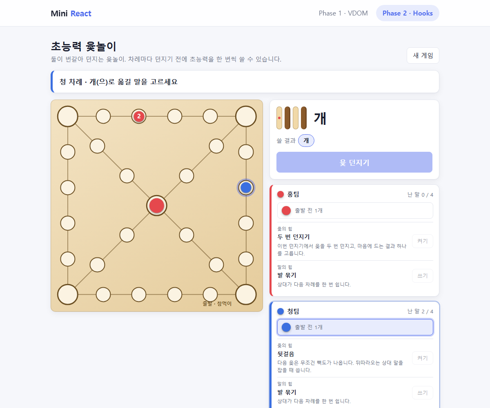
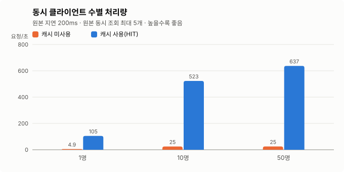
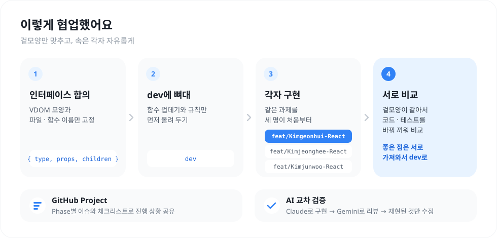

<div align="center">

# SW-AI W11-12 · FRAME-WORK

**React · Redis · DBMS를 외부 라이브러리 없이 직접 만들어 보는 3주 과제**


| | 프로젝트 | 핵심 | 결과 |
|:---:|---|---|---|
| ⚛️ | [**Mini React**](projects/react/README.md) | Virtual DOM · Diff · Patch, Component · Hooks | 1,000줄 중 1줄 바꾸기가 통째로 다시 그리기보다 **약 10배** 빠름 |
| 🗄️ | [**Mini Redis**](projects/redis/README.md) | 해시 테이블 키-값 저장소, TTL, 캐시 | 느린 API(0.2초) 앞 캐시로 응답 **45\~72배** 단축 |
| 🌳 | [**Mini DBMS**](projects/dbms/README.md) | SQL 처리기, B+ 트리 인덱스, 스레드 풀 서버 | 100만 행에서 id 검색 **0.17ms** (전체 탐색 약 4.5초) |

</div>

---

## 프로젝트

### ⚛️ Mini React — `projects/react`

<p align="center"></p>

- **Phase 1**: 실제 DOM → Virtual DOM 변환, 이전 VDOM과 Diff해 **바뀐 곳만** Patch, 뒤로가기 · 앞으로가기(State History)
- **Phase 2**: `FunctionComponent`, `useState` · `useEffect` · `useMemo`, Batching. 직접 만든 Hook으로 **초능력 윷놀이**를 구현
- 단위 테스트 276개, 무작위(퍼즈) 테스트 7,000건

```bash
# projects/react 폴더를 VS Code Live Server로 열기
index.html   # Phase 1
app.html     # Phase 2 (윷놀이)
tests/*.test.html
```

### 🗄️ Mini Redis — `projects/redis`

<p align="center"></p>

- **해시 테이블 직접 구현**: FNV-1a 해시 + 체이닝, 부하율 0.75에서 2배 리사이즈
- **HTTP JSON API**, 락 하나로 명령 원자성 보장, TTL(지연 삭제 + 주기 삭제), 60초 스냅샷
- **캐시 효과 측정**: 버전 키로 무효화 경쟁 상태를 막고, 원본 지연 · 적중률 · 동시 요청별로 비교
- 테스트 174개

```bash
cd projects/redis
python -m mini_redis.server --port 6380
python -m demo.benchmark --out docs/benchmark
```

### 🌳 Mini DBMS — `projects/dbms`

```
SQL → tokenizer → parser → executor ─┬─ WHERE id → B+ 트리 인덱스 (O(log n))
                                      └─ 그 외     → 전체 탐색   (O(n))
                                         ↓
                              테이블마다 JSON Lines 파일
```

- **Phase 1**: SQL 파일 실행 (`INSERT` · `SELECT`), 위치가 있는 문법 오류
- **Phase 2**: 메모리 B+ 트리 인덱스(order 64, 100만 행에서 높이 4), 순서대로 늘어나는 id에 맞춘 분할 최적화
- **Phase 3**: 스레드 풀 HTTP API 서버, 테이블별 읽기-쓰기 락, 큐가 차면 503
- **추가 구현**: `CREATE TABLE`, `DELETE`
- 테스트 130개

```bash
cd projects/dbms
python -m minidb examples/demo.sql
python -m minidb.server --port 8080
python -m minidb.bench            # 100만 행 인덱스 vs 전체 탐색
```

---

## 협업 방식

<p align="center"></p>

1. **인터페이스만 먼저 합의**합니다. 예: React는 VDOM 형식과 `src/core/`의 파일 · 함수 이름.
2. 그 뼈대를 `dev`에 올리고, 팀원이 각자 브랜치에서 **같은 과제를 처음부터** 구현합니다.
3. 구현이 끝나면 **같은 테스트와 기준으로 비교**해, 가장 완성도 높은 코드를 `dev`에 merge합니다.
4. AI는 구현에 활용하고 다른 AI로 교차 검증하되, **테스트로 재현되는 지적만** 반영합니다.

| 규칙 | 내용 |
|---|---|
| 브랜치 | `feat/이름-프로젝트` (`dev`에서 분기), PR은 `dev`로. `main`은 최종본만 |
| 커밋 | `feat:` 기능 · `fix:` 버그 · `docs:` 문서 · `test:` 테스트 · `refactor:` · `perf:` · `chore:` |
| 제약 | 외부 라이브러리 · 프레임워크 금지 (React는 Vanilla JS, Redis · DBMS는 Python 표준 라이브러리만) |

---

## 폴더 구조

```
projects/
├── react/   Mini React   (Vanilla JS, ES Modules)
├── redis/   Mini Redis   (Python 표준 라이브러리)
└── dbms/    Mini DBMS    (Python 표준 라이브러리)
```

각 프로젝트의 설계 · 성능 측정 · 한계는 해당 폴더의 `README.md`에 정리되어 있습니다.
