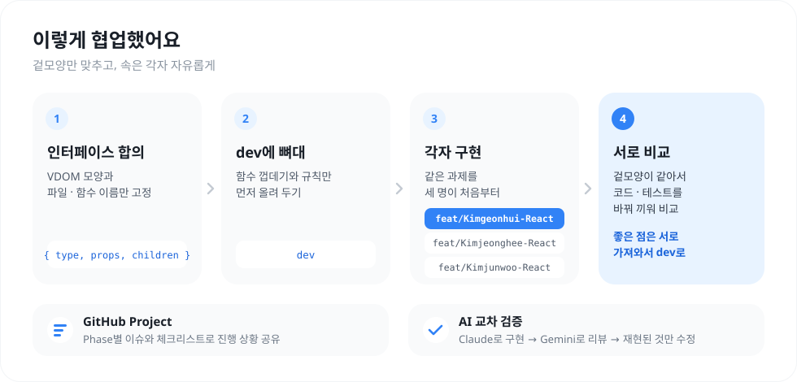
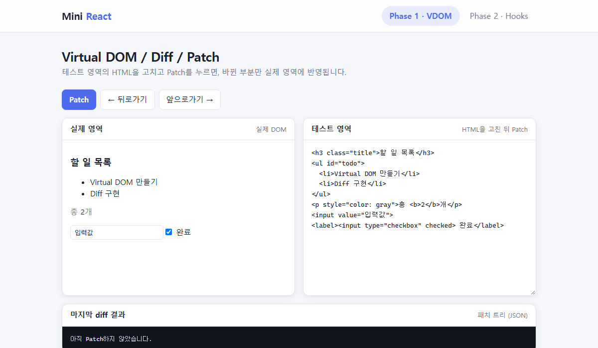
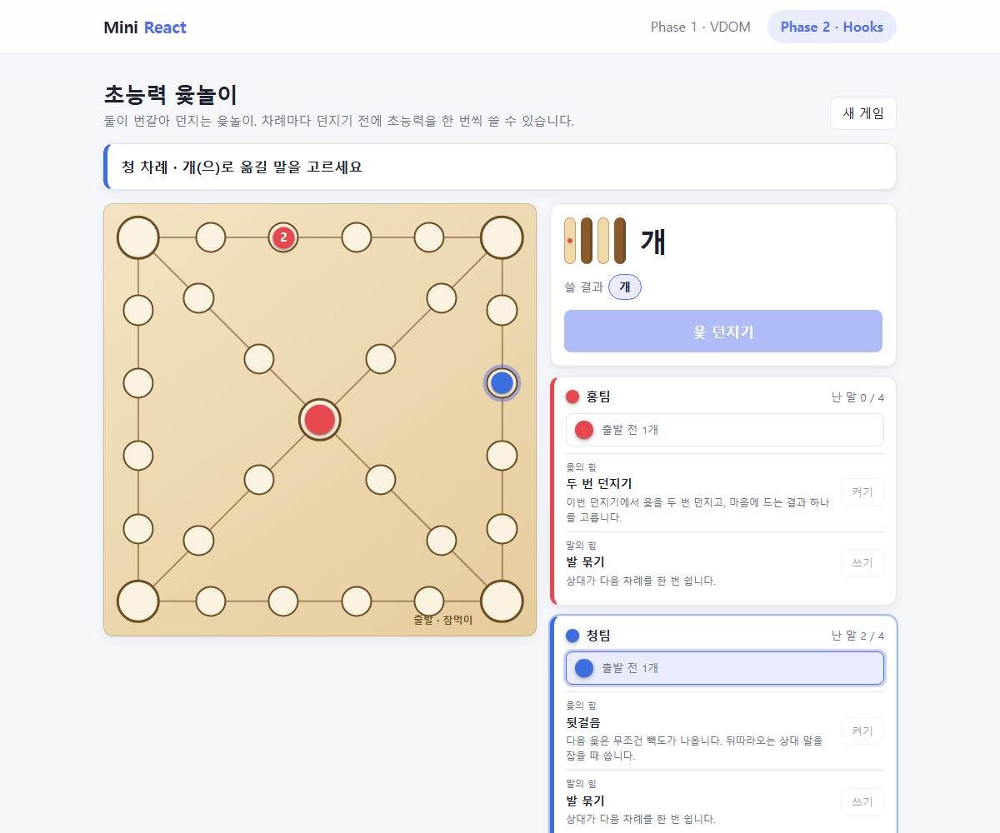
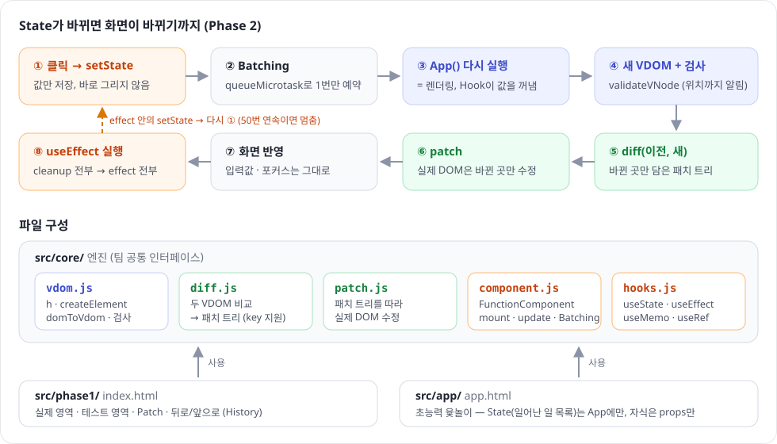
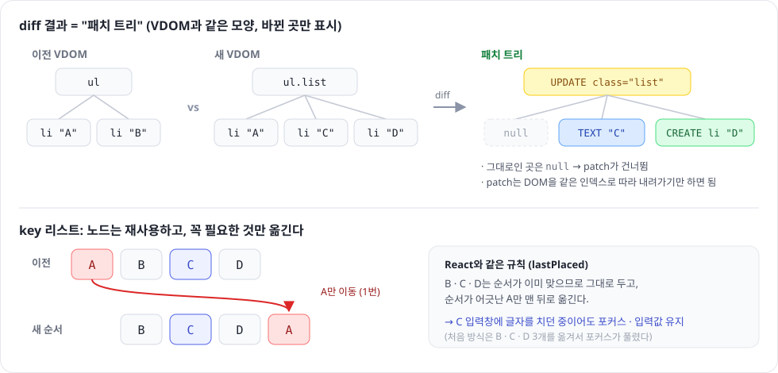

# Mini React

> 외부 라이브러리 없이 **Vanilla JavaScript**로 직접 만든 미니 React
> Phase 1 · Virtual DOM / Diff / Patch  ·  Phase 2 · Component / State / Hooks

| 언어 | 외부 라이브러리 | 단위 테스트 | 무작위(퍼즈) 테스트 |
|:---:|:---:|:---:|:---:|
| JavaScript (ES Modules) | **0개** | **275개** 통과 | 실행마다 **7,000건** 통과 |

**실행**: `projects/react` 폴더를 VS Code **Live Server**로 열기 → `index.html` (Phase 1) · `app.html` (Phase 2 초능력 윷놀이) · `tests/*.test.html` (테스트)

**발표 순서**: [1. 협업 방식](#1-협업-방식) → [2. 구현](#2-구현) → [3. 회고](#3-회고)

> 🎤 각 섹션의 **본문 문단**을 순서대로 읽으면 약 3분 30초입니다. 표와 그림은 화면으로 보여 주기만 합니다.

---

안녕하세요. Vanilla 자바스크립트로 미니 리액트를 만든 과정을 협업 방식, 구현, 회고 순서로 말씀드리겠습니다.

## 1. 협업 방식

<p align="center"></p>

협업은 먼저 **인터페이스를 맞추는 것**부터 시작했습니다.
VDOM 형식과 core의 파일 이름, 함수 이름은 고정하고, 내부 구현은 각자 자유롭게 하기로 했습니다.

이 뼈대를 dev 브랜치에 올린 뒤, 세 명이 **각자 브랜치에서 같은 과제를 처음부터** 구현했고, 진행 상황은 GitHub Project 이슈로 공유했습니다.

인터페이스가 같아서 **서로의 코드를 바꿔 끼워 비교**할 수 있었습니다.
실제로 팀원 코드와 비교하면서 제 코드에 입력 검사, 무한 렌더링 감지 같은 안전장치가 부족하다는 걸 발견하고 보완했습니다.

AI는 구현에 활용하고 다른 AI로 교차 검증했는데, 지적을 그대로 받지 않고 **테스트로 재현되는 것만** 고쳤습니다.

| 고정한 것 (팀 공통) | 자유롭게 한 것 (각자) |
|---|---|
| VDOM 모양 `{ type, props, children }`, 텍스트는 문자열 | diff 결과의 형식, patch 방식 |
| `src/core/` 파일 이름과 함수 이름 (`h`, `diff`, `patch`, `useState` …) | 내부 알고리즘, 테스트 방식 |

---

## 2. 구현

<table>
  <tr>
    <td width="50%"></td>
    <td width="50%"></td>
  </tr>
  <tr>
    <td align="center"><b>Phase 1</b> · HTML을 고치고 Patch → 바뀐 곳만 반영</td>
    <td align="center"><b>Phase 2</b> · Hooks로 만든 초능력 윷놀이 (팀마다 윷의 힘 · 말의 힘)</td>
  </tr>
</table>

### 기술 선택

| | 선택 | 이유 |
|---|---|---|
| 언어 | **JavaScript (ES Modules)** | 외부 프레임워크 금지. `import` / `export`로 파일을 나눔 |
| 실행 | **Live Server** (빌드 도구 없음) | 브라우저가 모듈을 직접 읽음 |
| 테스트 | **브라우저용 테스트 도구를 직접 만듦** | DOM이 필요해서 `*.test.html`을 열면 바로 결과가 나오게 함 |

언어는 자바스크립트를 활용했고, 외부 라이브러리 없이 ES 모듈로 파일을 나눴습니다. 실행은 VS Code 확장 프로그램인 Live Server를 활용했습니다.
테스트는 보통 Jest를 쓰는데, Node.js에서 돌아가서 DOM을 바로 쓸 수 없어서 **브라우저에서 돌아가는 테스트 도구를 직접** 만들었습니다.

<details>
<summary>용어 설명 (ES 모듈 · Live Server · Jest)</summary>

- **ES 모듈**: `export`로 함수를 내보내고 `import`로 가져다 쓰는 자바스크립트 표준 파일 나누기 문법. 브라우저가 `<script type="module">`로 직접 지원
- **Live Server**: 폴더를 로컬 웹 서버로 열어 주는 VS Code 확장. ES 모듈은 파일을 직접 열면(`file://`) 동작하지 않아서 필요
- **Jest**: 가장 많이 쓰는 자바스크립트 테스트 라이브러리. Node.js에서 돌아가서 DOM을 쓰려면 가짜 DOM 설정이 따로 필요

</details>

### 구성도: 한 번 클릭하면 일어나는 일

<p align="center"></p>

동작은 이 그림 한 장으로 설명할 수 있습니다.
클릭으로 setState가 불리면 바로 그리지 않고, **한 번만 다시 그리도록 예약**합니다.
그다음 App 함수를 다시 실행해 새 VDOM을 만들고, 이전 VDOM과 비교해서 **바뀐 곳만** 실제 DOM에 고칩니다. 화면이 바뀐 뒤에 useEffect가 실행됩니다.

### 핵심 설계 ① diff 결과 = 패치 트리, key는 꼭 필요한 것만 이동

<p align="center"></p>

diff 결과는 VDOM과 같은 모양의 **패치 트리**로 만들었습니다. 바뀐 곳만 표시하고 나머지는 null이라서, patch는 트리를 따라 내려가기만 하면 됩니다.
리스트는 **key로 같은 항목을 짝지어 노드를 재사용**하고, React와 같은 규칙으로 꼭 필요한 노드만 옮겨서 입력 중인 포커스도 유지됩니다.

### 핵심 설계 ② Hook = "배열 + 호출 순서"

```js
// 컴포넌트 객체가 hooks 배열을 들고 있고, Hook은 "몇 번째로 불렸는지"로 자기 칸을 찾는다
const [actions, setActions] = useState(start);            // hooks[0]  일어난 일의 목록 (던지기 · 옮기기 · 초능력)
const [selected, setSelected] = useState(0);               // hooks[1]  이번에 쓸 윷 결과
const state = useMemo(() => replay(actions), [actions]);   // hooks[…]  판 · 차례 · 승자는 목록에서 계산
```

Hook은 컴포넌트의 hooks 배열에 값을 저장하고, **호출 순서로 자기 칸**을 찾습니다.
그래서 조건문 안에서 Hook을 부르면 순서가 바뀌는데, 이런 실수는 **바로 에러가 나도록** 막았습니다.

| 과제 규칙 | 코드로 강제한 방법 |
|---|---|
| Hook은 루트 컴포넌트에서만 | 자식 컴포넌트 실행 중에 Hook을 부르면 에러 |
| Hook은 항상 같은 순서로 | 렌더링마다 Hook의 **개수와 종류**를 비교해서 다르면 에러 |
| 무한 렌더링 방지 | 렌더링 · effect 도중의 setState가 50번 연속이면 멈추고 에러 |

### 핵심 설계 ③ 검증: "patch한 화면 = 새로 그린 화면"

검증은 **"patch한 화면이 새로 그린 화면과 같은가"**라는 규칙 하나로 했습니다.
단위 테스트 275개와, 무작위로 만든 화면 **7천 건**으로 이 규칙을 확인합니다.

| 테스트 | 내용 | 결과 |
|---|---|---|
| 단위 테스트 (`tests/*.test.html`) | vdom 39 · diff 56 · hooks 37 · htmlText 7 · history 6 · yut 24 · ported 106 | **275 / 275** |
| 팀원 테스트 옮김 (`tests/ported.test.html`) | 김준우 님 테스트 중 형식만 달라 실패한 것을 같은 상황 그대로 내 형식으로 옮긴 106개 | 위에 포함 |
| 약속 테스트 | 샘플 36개의 모든 쌍 (1,296가지 전환) | 통과 |
| 무작위(퍼즈) 테스트 | key 목록 · 폼 · SVG · template을 섞은 화면 3,000쌍 + 사용자가 입력을 건드린 뒤 Patch 3,000쌍 + Phase 2 state 변경 1,000회 (시드 고정) | 통과 |

---

## 3. 회고

| | |
|---|---|
| 👍 **잘한 점** | 결과가 맞는지 **자동으로 확인하는 장치를 먼저** 만든 것 |
| 😵 **어려웠던 점** | **폼 요소**. 같은 값이라도 넣는 순서나 사용자가 건드렸는지에 따라 화면이 달라짐 |
| 💡 **배운 점** | key와 Hook 규칙이 **왜 필요한지** 직접 만들면서 이해함 |
| ➡️ **다음에는** | 처음부터 팀원과 코드를 **더 자주 비교**하기 |

잘한 점은 결과가 맞는지 자동으로 확인하는 장치를 먼저 만든 것입니다. 덕분에 리뷰 지적이 진짜 버그인지 바로 판단할 수 있었습니다.

어려웠던 점은 폼 요소였습니다. input의 값은 attribute와 property가 따로 있어서, 같은 값이라도 넣는 순서나 사용자가 건드렸는지에 따라 화면이 달라졌습니다.
예를 들어 range 입력은 value가 max보다 먼저 들어가면 100으로 잘려서, value를 항상 마지막에 넣도록 고쳤습니다.

배운 점은 리액트가 왜 key를 요구하는지, 왜 Hook을 조건문 안에서 쓰면 안 되는지 직접 만들어 보면서 이해했다는 것입니다.
다음에는 처음부터 팀원과 코드를 더 자주 비교해서, 서로의 좋은 점을 더 빨리 가져오고 싶습니다.

이상으로 발표를 마치겠습니다. 감사합니다.

---

<details>
<summary>📁 폴더 구조</summary>

```
projects/react/
├─ index.html · app.html        ← Phase 1 / Phase 2 페이지
├─ src/core/                    ← 엔진 (팀 공통 인터페이스)
│  ├─ vdom.js       h · createElement · domToVdom · validateVNode · setProp
│  ├─ diff.js       두 VDOM 비교 → 패치 트리 (key 지원)
│  ├─ patch.js      패치 트리를 실제 DOM에 반영
│  ├─ component.js  FunctionComponent (mount · update · unmount · Batching)
│  └─ hooks.js      useState · useEffect · useMemo · useRef
├─ src/phase1/                  ← 실제 영역 / 테스트 영역 / History
├─ src/app/                     ← 초능력 윷놀이 (App만 State, 자식 PowerPick · YutBoard · ThrowPanel · TeamPanel · YutLog는 props만, 규칙은 yut.js)
├─ tests/                       ← *.test.html 을 열면 결과 표시
└─ docs/                        ← DETAILS.md (이론 · 엣지 케이스), images/
```

</details>

> 이론 설명 · 엣지 케이스 · 실제 React와의 차이 (Q&A 대비): [`docs/DETAILS.md`](docs/DETAILS.md)
