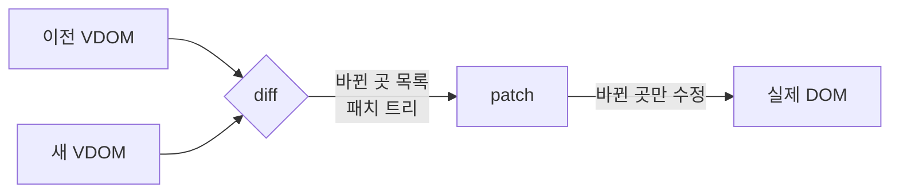
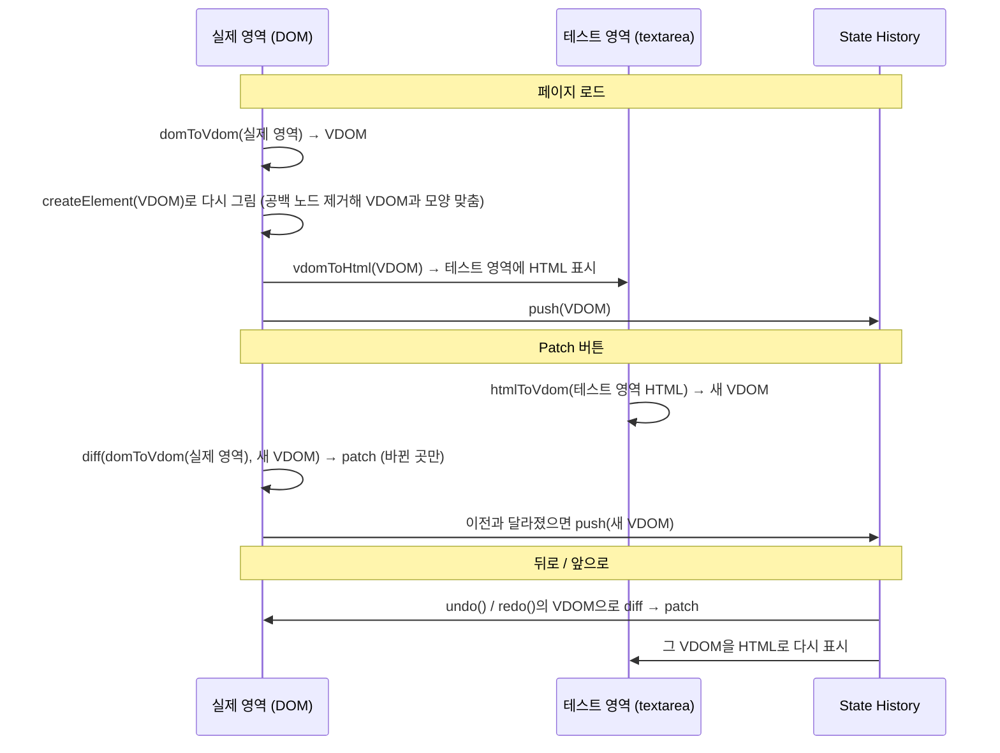
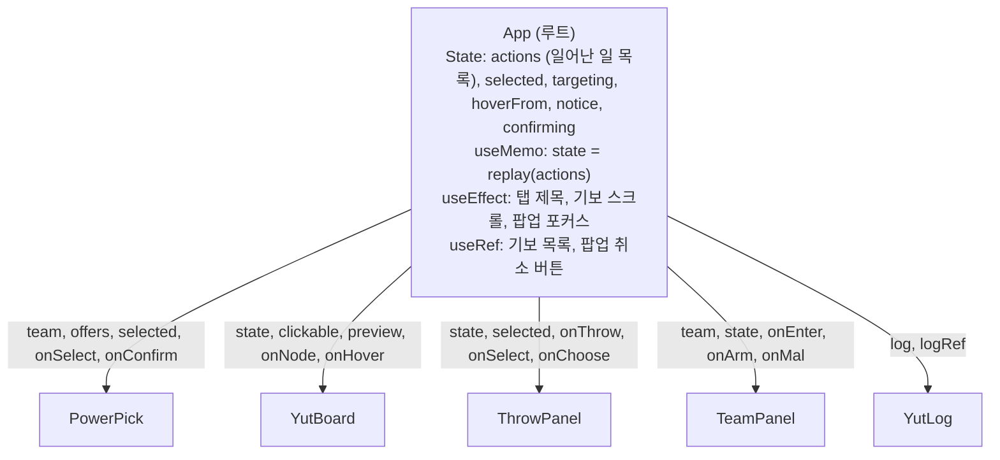
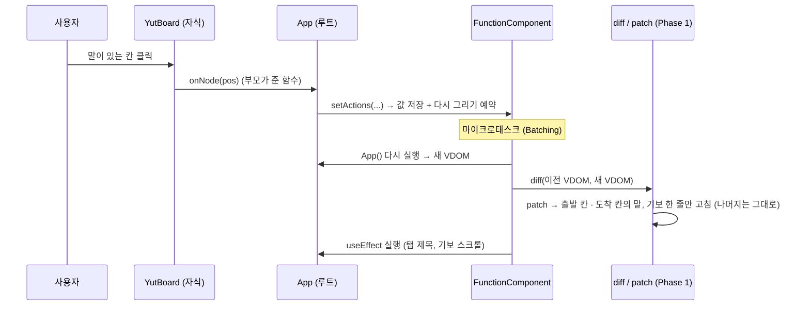

# Mini React — 자세한 설명 (질의응답용)

> Virtual DOM · Diff · Patch부터 Component · State · Hooks까지, **외부 라이브러리 없이 Vanilla JS로 직접 만든 React**

| | |
|---|---|
| **Phase 1** | 실제 DOM → Virtual DOM 변환, 두 VDOM을 비교하는 Diff, 바뀐 곳만 고치는 Patch, 뒤로/앞으로 가기 |
| **Phase 2** | 함수형 컴포넌트(`FunctionComponent`), `useState` · `useEffect` · `useMemo` (+ `useRef`), 초능력 윷놀이 데모 앱 (둘이 번갈아 던지기, 지름길 · 업기 · 잡기 · 한 번 더, 팀마다 윷의 힘 · 말의 힘 1개씩, 기보) |
| **추가 구현** | key 기반 리스트 비교, SVG, ref, 상태 변경 Batching, Hook 규칙 위반 감지 |
| **테스트** | 단위 테스트 **116개** (브라우저에서 실행) |

---

## 목차

1. [실행 방법](#1-실행-방법)
2. [폴더 구조](#2-폴더-구조)
3. [왜 Virtual DOM인가](#3-왜-virtual-dom인가)
4. [Phase 1 — Virtual DOM · Diff · Patch](#4-phase-1--virtual-dom--diff--patch)
5. [Phase 2 — Component · State · Hooks](#5-phase-2--component--state--hooks)
6. [Phase 1 ↔ Phase 2 연결: 상태가 바뀌면 일어나는 일](#6-phase-1--phase-2-연결-상태가-바뀌면-일어나는-일)
7. [테스트와 엣지 케이스](#7-테스트와-엣지-케이스)
8. [실제 React와의 차이](#8-실제-react와의-차이)

---

## 1. 실행 방법

빌드 도구가 없습니다. ES Modules(`import` / `export`)를 쓰므로 **파일을 직접 열면 안 되고 로컬 서버**로 열어야 합니다.

1. VS Code에서 `projects/react` 폴더를 엽니다.
2. **Live Server**로 아래 페이지를 엽니다.

| 페이지 | 내용 |
|---|---|
| `index.html` | **Phase 1** — 실제 영역 / 테스트 영역, Patch · 뒤로가기 · 앞으로가기 |
| `app.html` | **Phase 2** — 초능력 윷놀이 데모 앱 |
| `tests/*.test.html` | 단위 테스트. 열면 맨 위에 `N / N passed` 표시 |

> 💡 Windows에서는 주소를 `localhost` 대신 `127.0.0.1`로 열면 더 빠릅니다.

---

## 2. 폴더 구조

```
projects/react/
├── index.html / app.html        Phase 1 페이지 / Phase 2 페이지
├── src/
│   ├── core/                    ★ 미니 React 엔진 (팀 공통 인터페이스)
│   │   ├── vdom.js              h, domToVdom, createElement, setProp / removeProp
│   │   ├── diff.js              diff  — 두 VDOM 비교 → 패치 트리
│   │   ├── patch.js             patch — 패치 트리를 실제 DOM에 적용
│   │   ├── component.js         FunctionComponent — hooks 배열, mount / update
│   │   └── hooks.js             useState, useEffect, useMemo, useRef
│   ├── phase1/
│   │   ├── main.js              Phase 1 페이지 흐름 (로드 / Patch / 뒤로·앞으로)
│   │   ├── history.js           State History (배열 + 현재 위치)
│   │   └── htmlText.js          테스트 영역용 HTML 문자열 ↔ VDOM 변환
│   ├── app/
│   │   ├── App.js               루트 컴포넌트 (모든 State가 여기에)
│   │   ├── main.js              App을 #root에 mount
│   │   └── yut.js               윷놀이 규칙 + 초능력 (순수 함수: action 목록 → 판 · 차례 · 승자)
│   │   ├── games.js             두 게임을 같은 모양(size · cols · play · check)으로 묶은 목록
│   │   └── components/          PowerPick, YutBoard, ThrowPanel, TeamPanel, YutLog, ConfirmDialog (전부 Stateless)
│   └── styles/style.css
└── tests/                       *.test.html / *.test.js
```

---

## 3. 왜 Virtual DOM인가

### 실제 DOM이 느린 이유: Reflow와 Repaint

DOM을 바꾸면 브라우저는 화면을 다시 그리기 위해 아래 단계를 거칩니다.

```
DOM 변경 → Reflow(Layout): 요소들의 위치·크기 다시 계산 → Repaint: 픽셀 다시 칠하기 → 화면
```

| 단계 | 하는 일 | 일어나는 예 |
|---|---|---|
| **Reflow** | 위치와 크기를 다시 계산. 한 요소가 바뀌어도 부모·형제·자식까지 다시 계산할 수 있어 **비쌈** | 요소 추가·삭제, 글자 변경, `width` 변경 |
| **Repaint** | 계산된 결과대로 다시 칠함 | `color`, `background` 변경 |

그래서 **DOM을 적게, 필요한 곳만** 건드리는 것이 성능의 핵심입니다.

### Virtual DOM이 싼 이유

```js
// Virtual DOM 노드: 필드 3개짜리 평범한 JS 객체
{ type: "li", props: { className: "done" }, children: ["공부하기"] }
```

- 수백 개의 속성을 가진 DOM 노드와 달리 **필드가 3개뿐**입니다.
- 만들고 비교해도 **화면에 아무 일도 일어나지 않습니다** (Reflow·Repaint 없음).

👉 **비교는 싼 VDOM끼리 하고(Diff), 비싼 실제 DOM은 바뀐 곳만 고칩니다(Patch).**



> 정확히 말하면 VDOM이 "손으로 최적화한 DOM 조작"보다 빠른 것은 아닙니다. 장점은 **개발자가 무엇을 고칠지 계산하지 않아도, 전체를 다시 그리는 것보다 훨씬 적은 DOM 조작으로 화면을 맞춰 준다**는 점입니다.

---

## 4. Phase 1 — Virtual DOM · Diff · Patch

### 4-1. Virtual DOM 구조 (팀 공통 형식)

```js
// <div id="box">안녕<b>!</b></div>
{
  type: "div",
  props: { id: "box" },
  children: [
    "안녕",                                     // 텍스트 노드 = 그냥 문자열
    { type: "b", props: {}, children: ["!"] }   // 요소 노드 = 같은 모양의 객체 (재귀)
  ]
}
```

VDOM을 만드는 방법은 두 가지입니다.

| 함수 | 방향 | 쓰는 곳 |
|---|---|---|
| `h(type, props, ...children)` | 코드 → VDOM (JSX 대신) | Phase 2 컴포넌트 |
| `domToVdom(node)` | **실제 DOM → VDOM** | Phase 1 페이지 로드 |
| `createElement(vnode)` | VDOM → 실제 DOM (재귀) | 처음 그릴 때, 새 노드가 생길 때 |

#### 정규화 규칙: "같은 화면이면 같은 VDOM"

Diff가 쓸데없는 변경을 찾지 않도록 VDOM의 모양을 통일합니다 (`vdom.js`).

| 규칙 | 이유 |
|---|---|
| 이웃한 텍스트는 하나로 합치고, 빈 문자열은 버림 | 브라우저도 붙어 있는 텍스트를 노드 하나로 다룸. 개수가 같아야 "i번째 = i번째" 비교가 맞음 |
| 줄바꿈이 섞인 공백 노드(HTML 들여쓰기)는 버림 | 화면에 의미 없음. 남기면 자식 인덱스가 밀림 (단, `<pre>` · `<textarea>` 안은 보존) |
| 주석 노드는 버림 | 화면에 그려지지 않음 |
| `style`은 camelCase 객체 (`{ fontSize: "12px" }`) | 문자열이면 속성 순서만 달라도 "다름"이 됨 |
| `checked` / `selected`는 `true`이거나 아예 없음 | 같은 상태를 한 가지 모양으로 |
| input의 **현재 값**(property)을 읽음 | 사용자가 입력한 값은 attribute가 아니라 property에만 있음 (`readLiveState`) |

### 4-2. Diff — 바뀐 곳 찾기 (`diff.js`)

두 VDOM을 **같은 위치끼리** 재귀적으로 비교하고, 결과를 **VDOM과 같은 모양의 "패치 트리"**로 돌려줍니다.

#### 최소 변경을 찾기 위한 5가지 핵심 케이스

| # | 상황 | 패치 | 실제 DOM 작업 |
|---|---|---|---|
| 1 | 이전엔 없고 이번엔 있음 | `CREATE` | 새로 만들어 붙임 (`appendChild`) |
| 2 | 이전엔 있고 이번엔 없음 | `REMOVE` | 지움 (`removeChild`) |
| 3 | 태그가 다름 / 텍스트 ↔ 요소 | `REPLACE` | 통째로 교체 (`replaceChild`). `<p>`를 `<div>`로 바꾸는 DOM API는 없음 |
| 4 | 둘 다 텍스트인데 글자가 다름 | `TEXT` | 글자만 바꿈 (`nodeValue`). 노드는 재사용 |
| 5 | 태그가 같음 | `UPDATE` | 노드는 그대로 두고 **속성만** 고치고, **자식으로 재귀** |
| — | 아무것도 안 바뀜 | `null` | 아무것도 안 함 |

```js
diff(
  h("ul", null, h("li", null, "A")),
  h("ul", null, h("li", null, "B"), h("li", null, "C"))
)
// → { type: "UPDATE", props: [], children: [
//      { type: "UPDATE", props: [], children: [{ type: "TEXT", text: "B" }] },  // li 재사용, 글자만
//      { type: "CREATE", node: { type: "li", ... "C" } }                         // 새 li
//    ] }
```

**속성 비교** (`diffProps`): 바뀐 속성 · 새로 생긴 속성 · 사라진 속성을 `[{ name, value, oldValue }]` 목록으로 만듭니다. `style`은 객체라서 키 하나하나를 비교합니다.

**패치 트리 모양을 택한 이유**: patch가 실제 DOM을 "같은 인덱스로" 따라 내려가기만 하면 되어서, 노드 경로(`[0, 2, 1]` 같은)를 따로 계산할 필요가 없습니다.

### 4-3. Patch — 실제 DOM에 반영 (`patch.js`)

패치 트리와 실제 DOM 트리를 **함께 내려가면서** 바뀐 곳만 고칩니다.

| 신경 쓴 점 | 이유 |
|---|---|
| 자식을 고치기 전에 `[...node.childNodes]`로 **목록을 복사** | `childNodes`는 살아 있는 목록이라, 하나를 지우면 뒤 인덱스가 당겨져 엉뚱한 노드를 고치게 됨 |
| **자식을 먼저, 속성은 나중에** 적용 | `<select>`의 `value`는 해당 `<option>`이 이미 있어야 적용됨 |
| `value`는 항상 **맨 마지막** 속성으로 적용 | `<input type="range" max="500" value="300">`에서 `max`보다 `value`가 먼저 들어가면 기본 최대값(100)으로 잘림 |
| `value` · `checked`는 attribute가 아니라 **property**로 | `setAttribute("value")`는 초기값만 바꿈. 화면에 보이는 값은 `el.value` |

### 4-4. key — 리스트를 똑똑하게 비교하기 (추가 구현)

같은 위치끼리만 비교하면, 리스트 **맨 앞을 지울 때** 문제가 생깁니다.

```
이전: [A, B, C]      새: [B, C]

key 없음 (위치 비교) → 0번 A를 B로 글자 변경, 1번 B를 C로 글자 변경, 2번 삭제
                     → DOM 노드는 제자리, 내용만 밀림. 입력 중인 값·포커스가 다른 항목에 남음 ❌
key 있음 (이름 비교) → A 노드만 삭제. B, C 노드는 그대로 재사용 ✅
```

`h("li", { key: item.id }, ...)`처럼 key를 주면, 같은 key끼리 짝지어 노드를 재사용하고 `insertBefore`로 **자리만 옮깁니다** (이미 문서에 있는 노드를 `insertBefore`하면 복사가 아니라 이동이라서 상태가 함께 따라감).

### 4-5. Phase 1 페이지 흐름 (`phase1/main.js`)



- **State History** (`history.js`): 배열 + 현재 위치(`index`) 하나로 관리. 뒤로 간 상태에서 새로 Patch하면 "앞으로 갈 수 있던 기록"은 버립니다 (브라우저 뒤로가기와 같은 규칙).
- **이전 VDOM을 화면에서 다시 읽는 이유**: 사용자가 실제 영역의 input에 직접 입력했다면, 그 상태까지 비교해서 테스트 영역 기준으로 되돌리기 위해서입니다.
- 마지막 diff 결과(패치 트리 JSON)를 화면 아래에 보여 줍니다.

---

## 5. Phase 2 — Component · State · Hooks

### 5-1. 핵심 질문: 함수는 매번 새로 실행되는데, 상태는 어떻게 유지할까?

함수 안의 지역 변수는 실행이 끝나면 사라집니다. 그래서 **상태를 함수 밖**, `FunctionComponent` 객체의 `hooks` 배열에 둡니다.

```
App() 1번째 실행                          App() 2번째 실행 (setState 후)
  useState(0)   → hooks[0] 만들고 0 저장     useState(0)   → hooks[0]에서 1 꺼냄 (초기값 무시)
  useState("")  → hooks[1] 만들고 "" 저장    useState("")  → hooks[1]에서 "" 꺼냄
  useMemo(...)  → hooks[2]                  useMemo(...)  → hooks[2]
```

- 렌더링 직전에 "지금 그리는 컴포넌트"를 `currentComponent`에 적어 두고, `hookIndex`를 0으로 되돌립니다.
- Hook은 부를 때마다 `hookIndex`를 1씩 올리며 **호출 순서로 자기 칸**을 찾습니다.
- 그래서 **Hook을 `if` · `for` 안에서 부르면 안 됩니다.** 순서가 달라지면 다른 Hook의 칸을 읽게 됩니다. → 우리 구현은 렌더링마다 Hook 개수를 비교해서 **바뀌면 에러**를 냅니다.

### 5-2. FunctionComponent (`component.js`)

| 멤버 | 역할 |
|---|---|
| `hooks` | Hook별 저장 칸 (렌더링이 끝나도 남아서 상태가 유지됨) |
| `mount()` | 처음 렌더링: 컴포넌트 실행 → VDOM → `createElement`로 전체를 그림 → effect 실행 |
| `update()` | 다시 렌더링: 새 VDOM → **이전 VDOM과 diff → patch** → effect 실행 |
| `vdom` | 지금 화면에 그려진 VDOM. 다음 diff의 기준 (화면에서 다시 읽지 않아서 `onClick` 같은 함수도 보존) |
| `scheduleUpdate()` | setState가 부름. 다시 그리기를 **예약**(Batching) |

### 5-3. Hooks (`hooks.js`)

| Hook | 저장하는 것 | 동작 |
|---|---|---|
| `useState(초기값)` | `{ state, setState }` | 첫 렌더링에만 초기값 사용. `setState`는 **항상 같은 함수** |
| `useEffect(fn, deps)` | `{ deps, cleanup }` | deps가 바뀐 경우에만, **화면 반영 후** 실행. 다시 실행 전에 이전 cleanup 호출 |
| `useMemo(fn, deps)` | `{ value, deps }` | deps가 같으면 이전 계산 결과를 재사용 |
| `useRef(초기값)` | `{ current }` | 렌더링마다 같은 객체. 바꿔도 다시 그리지 않음. `h("input", { ref })`로 DOM 요소를 담음 |

#### setState는 상태 변경 외에 무엇을 할까?

1. 값을 저장한다 (함수를 넘기면 최신 값으로 계산: `setCount(c => c + 1)`)
2. 값이 같으면(`Object.is`) 아무것도 안 한다
3. **다시 그리기를 예약한다** — 화면을 직접 고치지 않고, diff / patch에 맡긴다

#### Batching: 여러 상태 변경을 한 번에 (선택 과제)

```js
set((c) => c + 1);
set((c) => c + 1);
set((c) => c + 1);    // 세 번 불러도 다시 그리기는 1번 (결과는 +3)
```

`setState`는 바로 그리지 않고 `queueMicrotask`로 **"지금 하던 일이 끝난 직후"에 한 번만** 그리도록 예약합니다. 중간 상태가 화면에 보이지 않고, diff · patch도 한 번만 일어납니다.

### 5-4. 컴포넌트 구조와 State 위치 — Lifting State Up



- **State는 루트(`App`)에만** 둡니다. 자식은 **props만 받아 그리는 순수 함수**(Stateless)입니다.
- 자식이 상태를 바꾸고 싶으면 부모가 넘겨준 함수(`onNode`, `onThrow` 등)를 부릅니다 → 부모의 `setState` → 다시 렌더링.
- 게임의 State는 **"일어난 일(action)의 목록"** 하나입니다. 판 · 차례 · 승자는 `useMemo` 안에서 목록을 처음부터 다시 적용해서(replay) 만듭니다.
- 윷처럼 무작위인 일은 App이 결과를 정해 action에 담습니다 (`{ type: "throw", name: "걸" }`). 그래서 같은 목록이면 언제 다시 계산해도 같은 판이고, 규칙 테스트도 주사위 없이 할 수 있습니다.
- 과제 제약을 **코드로 강제**합니다: 자식 컴포넌트 안에서 Hook을 부르면 에러가 납니다.

**UI를 나눈 기준**: 화면에서 **역할이 하나인 덩어리**마다 컴포넌트 하나 (초능력 고르기 / 윷판 / 윷 던지기 / 팀 / 기보 / 확인 팝업).

---

## 6. Phase 1 ↔ Phase 2 연결: 상태가 바뀌면 일어나는 일

윷을 던진 뒤 옮길 말(칸)을 눌렀을 때의 전체 흐름입니다.



**전체를 다시 그리지 않습니다.** App은 화면 전체(약 130개 요소)를 매번 새 VDOM으로 만들지만, 말 하나를 옮길 때 실제 DOM 변경은 **12~19개**뿐인 것을 `MutationObserver`로 확인했습니다 (출발 · 도착 칸의 말, 누를 수 있는 칸 강조, 상황 글자, 기보 한 줄, 팀 패널의 말 수).

---

## 7. 테스트와 엣지 케이스

`tests/*.test.html`을 Live Server로 열면 바로 실행됩니다. 외부 테스트 라이브러리 없이 작은 테스트 도구를 직접 만들었습니다 (DOM API가 브라우저에만 있어서 브라우저에서 실행).

| 파일 | 개수 | 내용 |
|---|---|---|
| `vdom.test` | 39 | h, domToVdom, createElement, 속성 적용, 이벤트, SVG, ref |
| `diff.test` | 40 | 5가지 케이스, patch, key, **약속 테스트** |
| `hooks.test` | 24 | FunctionComponent, useState(Batching), useEffect, useMemo, useRef, Hook 규칙 |
| `htmlText.test` | 7 | HTML ↔ VDOM 왕복 |
| `history.test` | 6 | 뒤로 / 앞으로 / 기록 자르기 |
| **합계** | **116** | |

### 약속 테스트: "patch한 결과 = 처음부터 새로 그린 결과"

사례를 하나씩 적는 대신, **VDOM 샘플 36개의 모든 쌍**(36 × 36 = 1,296가지 전환)에 대해 아래를 자동으로 확인합니다.

```
patch(createElement(A), diff(A, B))  의 화면  ==  createElement(B)  의 화면
```

화면 비교는 `domToVdom`으로 해서 **input 값 · 체크 상태 · select 선택 · textarea 값**까지 봅니다. 이 테스트가 select · textarea · range 관련 버그를 여러 개 찾아냈습니다.

### 다룬 엣지 케이스 (일부)

| 분류 | 케이스 |
|---|---|
| 노드 | 공백·주석 노드, 이웃 텍스트 합치기, `<pre>` 공백 보존, 자식 개수 증가·감소 |
| 속성 | 추가 · 변경 · 삭제, `disabled: true → false`, style 키 삭제, CSS 변수(`--gap`) |
| 폼 | input `value` / `checked`, select 단일·다중 선택, textarea 값, range의 `max`와 `value` 순서, input `type` 변경 |
| 리스트 | key 이동 · 삭제 · 앞 삽입, 중복 key, key 있음과 없음 혼합 |
| Hooks | 같은 값 setState 무시, 함수형 업데이트 누적, effect cleanup 순서, effect 안의 setState, 렌더링 중 에러 후 복구, Hook 개수 변경 감지 |

---

## 8. 실제 React와의 차이

| | 실제 React | Mini React |
|---|---|---|
| JSX | `<li className="a">` | `h("li", { className: "a" })` |
| Hook 위치 | 모든 컴포넌트에서 사용 | **루트에서만** (과제 제약, 코드로 강제) |
| 다시 그리기 범위 | 상태가 바뀐 컴포넌트부터 | 항상 **루트부터 전체** 실행 후 diff |
| 렌더링 엔진 | Fiber: 작업을 쪼개서 중간에 멈출 수 있음 | 한 번에 끝까지 (재귀) |
| 리스트 비교 | key + 이동 최소화 계산 | key 지원, "자리가 다를 때만 이동" |
| 이벤트 | 루트 한 곳에 위임 (Synthetic Event) | 요소마다 직접 등록 (최신 핸들러로 교체) |
| `useEffect` 실행 시점 | 화면을 그린 **뒤** (비동기) | patch 직후 동기 실행 |
| 기타 | Context, Suspense, Error Boundary, `memo` 등 | 없음 |

### 중점 포인트 정리

<details>
<summary><b>브라우저에서 DOM을 다루는 방법 (Document, Window)</b></summary>

- `window`: 브라우저 창 전체 (전역 객체). 타이머, 주소, `localStorage` 등
- `document`: 그 창에 열린 HTML 문서. DOM 트리의 시작점
- 이 프로젝트에서 쓰는 API: `document.createElement` / `createElementNS`(SVG), `createTextNode`, `appendChild`, `insertBefore`, `replaceChild`, `removeChild`, `setAttribute`, `addEventListener`, `el.style`, `node.childNodes`

</details>

<details>
<summary><b>실제 DOM의 변화를 감지하는 브라우저 API</b></summary>

- `MutationObserver`: DOM에 자식 추가·삭제, 속성 변경, 글자 변경이 일어나면 알려 주는 API
- 이 프로젝트에서는 개발 중 "입력창에 한 글자를 칠 때 DOM 변경이 몇 개인지"를 콘솔에서 확인하는 데 사용했습니다 (부분 업데이트 검증, 프로젝트 코드에는 포함되지 않음)

</details>

<details>
<summary><b>React에서 실제 DOM을 바꿀 때 VDOM과 Diff의 동작</b></summary>

1. 상태가 바뀌면 컴포넌트를 다시 실행해 **새 VDOM**을 만든다
2. **이전 VDOM과 비교(Diff)**해서 바뀐 곳만 찾는다 (태그가 다르면 통째로 교체, 같으면 속성·자식만 비교, 리스트는 key로 짝짓기)
3. 찾은 변경만 **실제 DOM에 반영(Patch)**한다 → Reflow·Repaint 최소화

</details>
