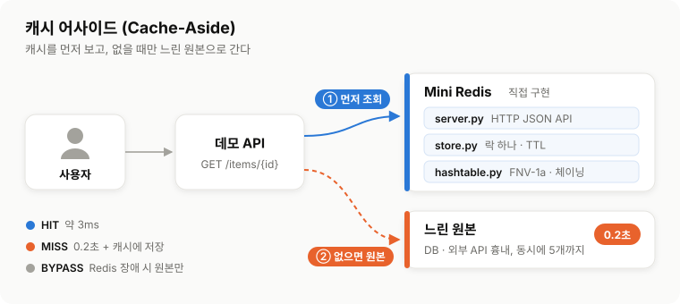
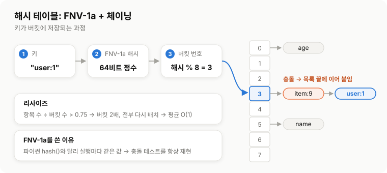
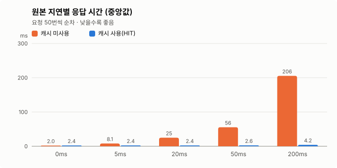
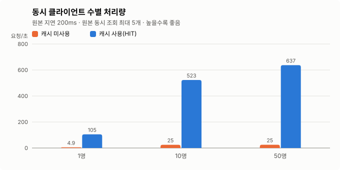

<div align="center">

# Mini Redis

**해시 테이블부터 직접 만든 키-값 저장소를, 느린 API 앞에 캐시로 붙여 본 프로젝트**


| 🧩 외부 라이브러리 | ✅ 테스트 | ⚡ 캐시 효과 (원본 0.2초) | 👥 동시 50명 처리량 |
|:---:|:---:|:---:|:---:|
| **0개** | **174개** 통과 | 응답 **45~72배** 빠름 | **13배** |

</div>

**실행** (`projects/redis` 폴더)

```bash
python -m mini_redis.server --port 6380                               # Mini Redis 서버
python -m demo.api_server --port 8000 --redis http://127.0.0.1:6380   # 캐시를 쓰는 데모 API
python -m demo.benchmark --out docs/benchmark                         # 성능 비교 (약 1분)
python -m unittest discover -s tests -t .                             # 테스트
```

**발표 순서**: [1. 무엇을 만들었나](#1-무엇을-만들었나) → [2. 핵심 설계](#2-핵심-설계) → [3. Pintos와 같은 발상](#3-지난주-pintos와-같은-발상) → [4. 성능](#4-성능) → [5. 회고](#5-회고)
&nbsp;·&nbsp; 발표 대본: [docs/SCRIPT.md](docs/SCRIPT.md) &nbsp;·&nbsp; API · 설계 · 측정 방법 전체: [docs/DETAILS.md](docs/DETAILS.md)

---

## 1. 무엇을 만들었나

<p align="center"></p>

| 만든 것 | 내용 |
|---|---|
| **Mini Redis** | 해시 테이블을 직접 구현한 키-값 저장소. HTTP JSON API (`GET` · `PUT` · `DELETE /keys/{key}`) |
| **데모 API** | 조회에 0.2초 걸리는 아이템 API. 응답을 Mini Redis에 캐시 |
| **벤치마크** | 캐시 사용 / 미사용을 네 가지 상황에서 비교, 그래프 생성 |

## 2. 핵심 설계

### ① 해시 테이블

<p align="center"></p>

### ② 동시성 · 만료 · 저장

| 주제 | 어떻게 | 왜 |
|---|---|---|
| 동시성 | 모든 명령을 **락 하나** 안에서 실행 | 리사이즈 중에 다른 스레드가 쓰면 키가 사라짐. Redis의 "한 번에 명령 하나"와 같은 효과 |
| 만료(TTL) | **지연 삭제**(읽을 때) + **주기 삭제**(1초마다) | 지연은 **정확성**(만료된 값이 안 나감), 주기는 **메모리**(안 읽히는 키 정리) |
| 서버 다운 대비 | 60초마다 스냅샷: 임시 파일 → `fsync` → `os.replace` | 저장 도중 죽어도 기존 파일은 온전함 |

### ③ 캐시 무효화: 버전 키

<p align="center"></p>

## 3. 지난주 Pintos와 같은 발상

| | Pintos (C) | Mini Redis (Python) |
|---|---|---|
| **락 해제** | `lock_acquire` / `lock_release`를 직접 짝지음.<br>에러 경로에서 release를 빠뜨리면 **데드락** | `with self._lock:`<br>어떤 경로로 빠져나가도 **자동으로 release** |
| **미루기** | **지연 로딩**: 페이지를 실제로 접근할 때(page fault) 읽어 옴 | **지연 삭제**: 키를 실제로 읽을 때 만료를 확인해 지움 |
| **순간의 사진** | `fork()`의 **copy-on-write**: 공유하다가 쓰는 순간에만 복사 | `dump()`가 락 안에서 데이터를 복사하고,<br>느린 파일 쓰기는 락 밖에서 |

> 지연 로딩은 **만드는** 일을, 지연 삭제는 **지우는** 일을 필요한 순간까지 미룹니다. 아무도 안 쓰는 것에는 비용을 쓰지 않는다는 점이 같습니다.

## 4. 성능

| 원본이 느릴수록 캐시가 값지다 | 동시 요청이 많을수록 차이가 커진다 |
|:---:|:---:|
|  |  |

| 상황 | 결과 | 의미 |
|---|---|---|
| 같은 아이템 50번 | 205.8ms → **2.9ms** | HIT면 원본을 거치지 않음 |
| 원본 지연 0ms | 캐시가 **0.9배 (더 느림)** | 원본이 캐시 왕복보다 빠르면 손해 |
| 적중률 80% | p50 5.3ms, p95 **208.5ms** | 5명 중 1명은 여전히 느림 → **적중률이 핵심** |
| 동시 50명 | 24 → **327 요청/초** | 원본은 동시 5개 × 0.2초 = 초당 25건에서 멈춤 |
| 연결 재사용 | 캐시 조회 p50 3.4ms → **0.9ms** | HTTP/1.1 keep-alive + 연결 풀 |

## 5. 회고

| 배운 것 | 내용 |
|---|---|
| 🔍 **측정 도구부터 의심하기** | 같은 측정이 19~36배로 흔들렸는데, 원인은 캐시가 아니라 측정 도구였습니다. Windows에서 제한 시간을 건 연결의 약 40%가 15ms 이상 걸렸습니다. 고친 뒤 p95가 4~5ms로 고르게 나왔습니다 |
| 🤖 **AI 리뷰는 재현된 것만** | 다른 AI의 지적은 테스트로 재현되는 것만 고쳤습니다. 예: `Content-Length` 헤더 두 개로 요청을 숨겨 보내는 문제 |
| ⚖️ **한계** | 연결마다 스레드 하나라, 이벤트 루프를 쓰는 실제 Redis보다 연결 수에 약합니다. 여러 명령을 묶는 `INCR` · `MULTI`는 없습니다 |
