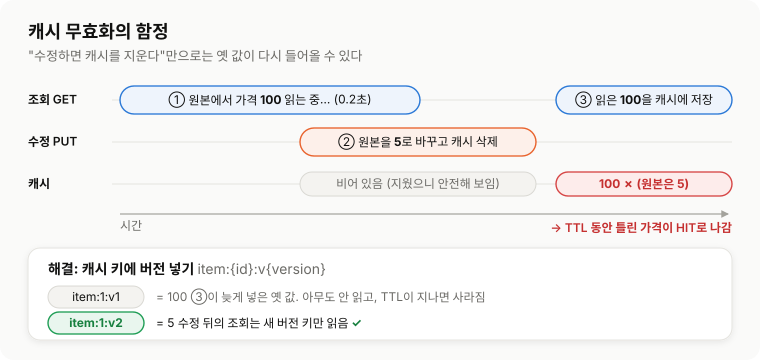

<div align="center">

# Mini Redis

**해시 테이블 기반 키-값 저장소 구현 및 캐시 성능 비교**


| 외부 라이브러리 | 테스트 | 응답 시간 (원본 0.2초) | 처리량 (동시 50명) |
|:---:|:---:|:---:|:---:|
| **0개** | **174개** 통과 | **45\~72배** 단축 | **13배** |

</div>

**실행** (`projects/redis` 폴더)

```bash
python -m mini_redis.server --port 6380                               # Mini Redis 서버
python -m demo.api_server --port 8000 --redis http://127.0.0.1:6380   # 캐시를 쓰는 데모 API
python -m demo.benchmark --out docs/benchmark                         # 성능 비교 (약 1분)
python -m unittest discover -s tests -t .                             # 테스트
```

**목차**: [1. 구현 방식](#1-구현-방식) → [2. 핵심 구현](#2-핵심-구현) → [3. Pintos와 비교](#3-pintos와-비교) → [4. 성능 측정](#4-성능-측정) → [5. 회고](#5-회고)
&nbsp;·&nbsp; 발표 대본: [docs/SCRIPT.md](docs/SCRIPT.md) &nbsp;·&nbsp; 상세 문서: [docs/DETAILS.md](docs/DETAILS.md)

---

## 1. 구현 방식

<p align="center"></p>

| 구성 요소 | 설명 |
|---|---|
| **Mini Redis** | 해시 테이블로 구현한 키-값 저장소. HTTP JSON API 제공 (`GET` · `PUT` · `DELETE /keys/{key}`) |
| **데모 API** | 조회에 0.2초가 걸리는 아이템 API. 조회 결과를 Mini Redis에 캐시 |
| **벤치마크** | 캐시 사용 · 미사용 응답 시간과 처리량 비교, 그래프 생성 |

## 2. 핵심 구현

### 해시 테이블

<p align="center"></p>

### 동시성 · 만료 · 저장

| 항목 | 구현 | 이유 |
|---|---|---|
| 동시성 | 모든 명령을 **락 하나** 안에서 실행 | 리사이즈 도중 다른 스레드가 쓰면 키가 사라질 수 있음 |
| 만료(TTL) | **지연 삭제**(읽을 때) + **주기 삭제**(1초마다) | 지연 삭제는 만료된 값이 응답으로 나가는 것을 막고, 주기 삭제는 읽히지 않는 키를 메모리에서 정리 |
| 영속성 | 60초마다 스냅샷 저장: 임시 파일 → `fsync` → `os.replace` | 저장 도중 서버가 꺼져도 기존 파일은 그대로 남음 |

### 캐시 무효화

<p align="center"></p>

## 3. Pintos와 비교

| | Pintos (C) | Mini Redis (Python) |
|---|---|---|
| **Lock** | `lock_acquire` / `lock_release`를 직접 짝지어 호출.<br>에러 경로에서 release를 빠뜨리면 **데드락** | `with self._lock:`<br>블록을 어떻게 빠져나가도 **자동으로 release** |
| **Lazy Loading** | 페이지에 실제로 접근할 때(page fault) 불러옴 | 키를 실제로 읽을 때 만료 여부를 확인해 삭제 |
| **Snapshot** | `fork()`의 **copy-on-write**: 공유하다가 쓰는 순간에만 복사 | `dump()`로 락 안에서 데이터만 복사하고,<br>파일 쓰기는 락 밖에서 처리 |

> Pintos는 불러오는 작업을, Mini Redis는 삭제 작업을 실제로 필요할 때까지 미룹니다.

## 4. 성능 측정

| 원본 지연에 따른 응답 시간 | 동시 사용자 수에 따른 처리량 |
|:---:|:---:|
|  |  |

| 조건 | 결과 | 비고 |
|---|---|---|
| 같은 아이템 50번 조회 | 205.8ms → **2.9ms** | HIT는 원본을 조회하지 않음 |
| 원본 지연 0ms | 캐시 사용 시 **0.9배** (더 느림) | 원본이 캐시 조회보다 빠르면 캐시가 손해 |
| 적중률 80% | p50 5.3ms, p95 **208.5ms** | MISS 요청은 여전히 0.2초 소요 |
| 동시 50명 | 24 → **327 요청/초** | 원본은 동시 5개 × 0.2초 = 초당 25건이 상한 |
| 연결 재사용 | 캐시 조회 p50 3.4ms → **0.9ms** | HTTP/1.1 keep-alive + 연결 풀 |

## 5. 회고

| 항목 | 내용 |
|---|---|
| **측정 오류** | 같은 측정이 19\~36배로 흔들렸고, 원인은 측정 도구였습니다. Windows에서 제한 시간을 건 연결의 약 40%가 15ms 이상 걸렸습니다. 수정 후 p95가 4\~5ms로 안정됐습니다 |
| **AI 리뷰 반영** | 다른 AI의 지적은 테스트로 재현되는 것만 수정했습니다. 예: `Content-Length` 헤더 두 개로 요청을 숨겨 보내는 문제 |
| **한계** | 연결마다 스레드를 하나씩 써서, 이벤트 루프를 쓰는 실제 Redis보다 많은 연결을 처리하기 어렵습니다. 여러 명령을 묶는 `INCR` · `MULTI`는 없습니다 |
