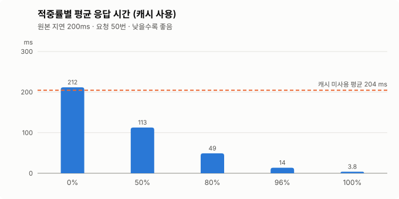

# Mini Redis

해시 테이블을 직접 구현해 만든 키-값 저장소입니다. HTTP JSON API로 외부 프로그램에서 쓸 수 있습니다.
Python 표준 라이브러리만 사용했고, 저장소 본체에는 파이썬 `dict`를 쓰지 않았습니다.

| 항목 | 내용 |
|---|---|
| 저장소 | 직접 만든 해시 테이블 (FNV-1a 해시, 체이닝, 부하율 0.75에서 2배 리사이즈) |
| 외부 사용 | HTTP JSON API (`GET` / `PUT` / `DELETE /keys/{key}` 등) |
| 동시성 | 모든 명령을 락 하나 안에서 실행 |
| 만료(TTL) | 읽을 때 지우기(지연 삭제) + 1초마다 정리(주기 삭제) |
| 무효화 | `DELETE`, 그리고 데모 API의 버전 키 |
| 서버 다운 대비 | 주기 스냅샷 저장, 켤 때 복구 (선택 과제) |
| 테스트 | 단위 · 기능 테스트 145개 모두 통과 |
| 성능 | 느린 API(0.2초) 앞에 캐시로 두면 평균 약 19~36배 빠름, 동시 50명에서 처리량 약 26배 (원본 지연별 · 적중률별 · 동시 요청까지 측정) |

---

## 실행 방법

`projects/redis` 폴더에서 실행합니다. Python 3.9 이상이면 됩니다. 설치할 패키지는 없습니다.

```bash
python -m mini_redis.server --port 6380
```

```bash
python -m demo.api_server --port 8000 --redis http://127.0.0.1:6380
```

```bash
python -m demo.benchmark --out docs/benchmark
```

```bash
python -m unittest discover -s tests -t .
```

- Mini Redis 서버는 기본으로 `data/dump.json`에 60초마다 저장하고, 켤 때 이 파일에서 복구합니다. `--snapshot ""`로 끌 수 있습니다.
- 벤치마크는 두 서버를 스스로 띄우므로 따로 켜 둘 필요가 없습니다.

사용 예시:

```bash
curl -X PUT http://127.0.0.1:6380/keys/user:1 -d '{"value": {"name": "메이플"}, "ttl": 60}'
curl http://127.0.0.1:6380/keys/user:1
curl -X DELETE http://127.0.0.1:6380/keys/user:1
```

---

## 구조

```
외부 클라이언트 (curl, 데모 API 등)
        │  HTTP JSON
        ▼
server.py      요청 하나마다 스레드 하나 (ThreadingHTTPServer), JSON 검사 후 저장소 호출
        │
        ▼
store.py       MiniRedis: set / get / delete / expire / ttl / sweep — 락 하나로 한 번에 명령 하나
        │
        ▼
hashtable.py   HashTable 두 개: _data(키 → 값), _expires(키 → 만료 시각)

persistence.py 스냅샷 저장 · 복구 (서버가 주기적으로 호출)
demo/          느린 아이템 API + Mini Redis 캐시, 성능 비교
```

| 파일 | 하는 일 |
|---|---|
| `mini_redis/hashtable.py` | 해시 테이블. `get`, `set`, `delete`, `keys`, `in` |
| `mini_redis/store.py` | `MiniRedis`. TTL과 락을 해시 테이블 위에 얹은 저장소 |
| `mini_redis/server.py` | HTTP JSON API 서버, 주기 삭제 스레드 |
| `mini_redis/persistence.py` | 스냅샷 저장 · 복구, 주기 저장 |
| `demo/api_server.py` | 기능 테스트용 아이템 API. 응답을 Mini Redis에 캐시 |
| `demo/benchmark.py` | 캐시 사용 / 미사용 비교: 기본 · 원본 지연별 · 적중률별 · 동시 요청, 그래프 SVG 생성 |

---

## API

| 메서드 · 경로 | 하는 일 | 응답 |
|---|---|---|
| `GET /keys/{key}` | 조회 | 200 `{"key", "value", "ttl"}` / 404 |
| `PUT /keys/{key}` | 저장. body `{"value": ..., "ttl": 초(선택)}` | 200 `{"ok": true}` |
| `DELETE /keys/{key}` | 삭제(무효화) | 200 `{"deleted": true/false}` |
| `GET /keys/{key}/ttl` | 남은 시간 | 200 `{"ttl": 초 / -1(만료 없음) / -2(키 없음)}` |
| `POST /keys/{key}/expire` | 만료 시간 설정. body `{"ttl": 초}` | 200 / 404 |
| `GET /health` | 상태 확인 | 200 `{"keys": 키 수}` |

- 키에 `/` 같은 특수문자가 있으면 URL 인코딩합니다. 예: `char:a/b` → `/keys/char%3Aa%2Fb`
- 오류도 모두 `{"error": "이유"}` 모양의 JSON입니다.
- 값의 중첩(`[[...]]`, `{"a": {...}}`)은 128단계까지입니다(실제 RedisJSON의 기본 상한과 같음). 상한이 없을 때는 깊이 1000 이상인 값 하나 때문에 스냅샷 저장이 매번 실패해 다른 키까지 디스크에 남지 않았습니다.

| 상태 코드 | 언제 |
|---|---|
| 400 | JSON이 아님, value 없음, null 값, 잘못된 ttl, NaN · Infinity, 잘린 본문, 중첩 128단계 초과 |
| 404 | 키 없음, 없는 경로 |
| 405 | 아는 메서드지만 이 경로에서 안 됨 (예: `POST /keys/a`) |
| 408 | 본문을 10초 안에 다 보내지 않음 |
| 411 | Content-Length 없이 chunked로 보낸 본문 |
| 413 | 본문이 1MB 초과 |
| 414 | 요청 주소가 너무 김 |
| 500 | 서버 내부 오류 (예: 파이썬 코드로 저장소에 직접 넣은, JSON으로 못 바꾸는 값을 조회) |
| 501 | 서버가 모르는 메서드 (HEAD, TRACE 등) |

**실제 Redis와 비교**

| | 실제 Redis | Mini Redis | 이렇게 한 이유 |
|---|---|---|---|
| 통신 방식 | 자체 프로토콜 RESP (TCP) | HTTP + JSON | 과제가 "API 형태"를 요구하고, `curl`이나 어느 언어의 HTTP 클라이언트로든 바로 쓸 수 있음 |
| 명령 표현 | `SET user:1 메이플 EX 60` | `PUT /keys/user:1` + `{"value": "메이플", "ttl": 60}` | 주소는 "무엇을", 메서드는 "무엇을 할지" (REST 스타일) |
| 기본 포트 | 6379 | 6380 | 실제 Redis와 같이 켜도 겹치지 않게 |
| 비용 | 요청이 작고 연결을 계속 재사용 | 요청마다 HTTP 헤더가 붙고 연결을 새로 맺음 | 쓰기 쉬운 대신 요청 하나가 더 무거움 |

---

## 핵심 설계

### ① 해시 테이블

```
buckets = [ [ ["a", 1], ["k", 7] ],   ← 0번 칸: 같은 칸에 온(충돌한) 항목 목록
            [],                       ← 1번 칸: 비어 있음
            [ ["b", 2] ], ... ]
```

1. 키를 **FNV-1a** 해시로 64비트 정수로 바꿉니다. FNV-1a는 널리 알려진 공개 알고리즘이고, 함수는 그 규칙대로 직접 작성했습니다.
   - 파이썬 내장 `hash()`를 쓰지 않은 이유: 해시 계산까지 직접 구현해 설명하기 위해서이고, `hash()`는 보안 때문에 실행할 때마다 값이 바뀌기 때문입니다. FNV-1a는 같은 키면 언제나 같은 값이라, "이 두 키는 같은 칸에서 충돌한다" 같은 테스트를 항상 똑같이 재현할 수 있습니다.
2. `정수 % 칸 수`로 칸 번호를 정합니다.
3. 그 칸의 목록에서 키를 찾습니다. 다른 키가 같은 칸에 오면(충돌) 목록에 이어 붙입니다. 이것이 **체이닝**입니다.

- **리사이즈**: `항목 수 / 칸 수`(부하율)가 0.75를 넘으면 칸을 2배로 늘리고 모든 항목을 다시 배치합니다. 칸 수가 바뀌면 칸 번호도 바뀌기 때문입니다. 부하율을 낮게 유지해서 평균 O(1)로 찾습니다. 모든 키가 한 칸에 몰리는 최악의 경우는 O(n)입니다.
- **삭제**: 칸 안의 순서는 의미가 없어서, 지울 자리에 마지막 항목을 옮기고 끝을 지웁니다. 뒤의 항목을 한 칸씩 당기지 않아도 됩니다.
- **체이닝을 고른 이유**: 빈 칸을 찾아 옆으로 옮기는 개방 주소법은 삭제할 때 "삭제됨" 표시를 따로 관리해야 합니다. 체이닝은 그 칸의 목록에서 빼기만 하면 됩니다.

### ② 동시성

HTTP 서버는 요청마다 스레드를 씁니다. 두 요청이 같은 해시 테이블을 동시에 고치면 구조가 깨질 수 있습니다. 예를 들어 리사이즈 도중에 다른 스레드가 저장하는 경우입니다.

그래서 `MiniRedis`의 모든 명령을 **락 하나** 안에서 실행해, 한 번에 명령 하나만 돌게 했습니다. 실제 Redis가 명령을 한 스레드에서 하나씩 처리하는 것과 같은 효과입니다. 명령 하나는 아주 짧아서 줄을 서도 기다리는 시간이 작습니다.

- **락은 `with self._lock:`으로만 잡습니다.** Pintos(C)에서는 `lock_acquire()` / `lock_release()`를 직접 짝지어 써서, 중간 `return`이나 에러 경로마다 release를 빠짐없이 챙겨야 했습니다. 하나라도 빠지면 락이 영원히 잠겨 다른 스레드가 모두 멈춥니다(데드락). 파이썬의 `with`는 `try/finally`와 같아서, 블록을 어떻게 빠져나가든(정상 종료, `return`, 예상 못한 에러) **자동으로 release**합니다. 그래서 release를 빠뜨리는 실수가 구조적으로 생기지 않습니다.

  ```python
  with self._lock:          # 아래 코드와 같은 뜻
      ...                   # self._lock.acquire()
                            # try:
                            #     ...
                            # finally:
                            #     self._lock.release()
  ```

  `with`가 막아 주는 건 **"release를 빠뜨리는 실수"뿐**입니다. 아래는 여전히 직접 지켜야 합니다.

  | 한계 | 어떻게 지켰나 |
  |---|---|
  | **같은 락을 두 번 잡으면 멈춤**. `threading.Lock`은 같은 스레드라도 이미 잡은 락을 다시 잡으려 하면 영원히 기다림 | 락 안에서 부르는 내부 함수(`_expire_if_needed`, `_remove`)는 락을 잡지 않고, "락을 잡은 상태에서만 부른다"고 주석으로 정함 |
  | **되돌려 주지는 않음**. 블록 중간에 에러가 나면 락은 풀리지만, 그 전까지 바꾼 데이터는 반쯤 바뀐 채 남음 | 에러가 날 수 있는 검사(`_check_ttl` 등)는 락을 잡기 **전에** 끝내고, 락 안에서는 실패하지 않는 작업만 함 |
  | **락을 오래 잡으면 모두가 기다림** | 락 안에서는 메모리 작업만 함. 스냅샷은 `dump()`로 데이터만 락 안에서 찍고, 느린 파일 쓰기는 락 밖에서 함 |
  | **여러 명령을 묶어 주지는 않음** | 명령 하나만 원자적. 아래 "실제 Redis와 비교"와 한계 참고 |

- `get_with_ttl`: 값과 남은 시간을 락 하나 안에서 함께 읽습니다. 따로 읽으면 그 사이에 다른 요청이 끼어들어 "값은 있는데 ttl은 -2" 같은 어긋난 결과가 나올 수 있습니다.
- `dump`: 스냅샷용 데이터도 락 안에서 한 번에 찍어서, 저장 도중 바뀐 값이 섞이지 않습니다.

**실제 Redis와 비교**

| | 실제 Redis | Mini Redis | 이렇게 한 이유 |
|---|---|---|---|
| 명령 실행 | 스레드 **하나**가 명령을 순서대로 하나씩 실행 | 요청마다 스레드, 저장소 명령은 **락 하나**로 한 번에 하나씩 | 파이썬 표준 라이브러리의 `ThreadingHTTPServer`를 그대로 쓰면서, 락으로 같은 효과를 냄 |
| 동시 접근 보호 | 동시에 실행되는 명령이 없어 락이 필요 없음 | `with self._lock:`으로 보호 | 스레드가 여럿이라 락이 없으면 리사이즈 도중 키가 사라짐 |
| 여러 명령을 묶기 | `INCR`(읽고 더하기를 한 명령으로), `MULTI`/`EXEC`(트랜잭션) | 없음. 명령 하나만 원자적 | 과제 범위 밖. 클라이언트가 GET 후 PUT하면 그 사이에 다른 요청이 끼어들 수 있음 (한계 참고) |

### ③ 만료된 값 처리 (TTL)

만료 시각은 값과 다른 해시 테이블(`_expires`)에 둡니다. 실제 Redis와 같은 두 가지 방식을 함께 씁니다.

1. **지연 삭제**: 키를 읽을 때 만료됐으면 그 자리에서 지우고 "없음"으로 응답합니다. 그래서 만료된 값은 절대 응답으로 나가지 않습니다.
   - Pintos의 **지연 로딩**(lazy loading)과 같은 발상입니다. 지연 로딩은 페이지를 실제로 접근할 때(page fault) 비로소 읽어 오고, 지연 삭제는 키를 실제로 읽을 때 비로소 만료를 확인해 지웁니다. 둘 다 "필요한 순간까지 일을 미뤄서, 아무도 쓰지 않는 것에는 비용을 쓰지 않는다"입니다. 차이는 지연 로딩이 **만드는** 일을 미루고, 지연 삭제는 **지우는** 일을 미룬다는 점입니다.
2. **주기 삭제**: 아무도 읽지 않는 만료 키도 메모리에서 치우도록, 서버가 1초마다 `sweep()`을 부릅니다.

두 방식은 역할이 다릅니다. 주기 삭제만 있으면 다음 정리 전까지(최대 1초) 만료된 값이 응답으로 나갈 수 있고, 지연 삭제만 있으면 다시 읽히지 않는 키가 메모리에 영원히 남습니다. **지연 삭제는 정확성, 주기 삭제는 메모리**를 맡습니다.

**실제 Redis와 비교**: 실제 Redis도 같은 두 방식(passive / active)으로 만료합니다. ([Redis 문서: How Redis expires keys](https://redis.io/docs/latest/commands/expire/#how-redis-expires-keys))

| | 실제 Redis | Mini Redis | 이렇게 한 이유 |
|---|---|---|---|
| 주기 삭제 범위 | TTL 있는 키 중 **무작위로 일부만** 검사 | TTL 있는 키 **전부** 검사 | 과제 규모에서는 키가 적어 전부 훑어도 빠르고, 코드가 단순함. 키가 수십만 개가 되면 일부만 뽑는 방식으로 바꿔야 함 |
| 만료 시각 기준 | 컴퓨터 시계(유닉스 시각) | `time.monotonic` (뒤로 가지 않는 시계) | 컴퓨터 시계를 바꿔도 만료 계산이 꼬이지 않게. 대신 스냅샷에는 "남은 시간"을 저장 (⑤ 참고) |
| 0 이하 TTL | 키를 바로 삭제 | 400 에러로 거부 | 잘못된 입력을 조용히 삭제로 처리하지 않고 알려 주기 위해 |

- 시계는 `time.monotonic`을 씁니다. 컴퓨터 시계를 바꿔도 뒤로 가지 않아서 만료 계산이 꼬이지 않습니다.
- `ttl`은 1ms(0.001초) 이상의 유한한 숫자만 받습니다. 이보다 작으면 `지금 시각 + ttl`이 부동소수점에서 지금 시각과 같아져 저장하자마자 만료됩니다.
- 실제 Redis처럼 `PUT`(SET)은 이전 TTL을 지웁니다.

### ④ 무효화

- **직접 삭제**: `DELETE /keys/{key}`.
- **버전 키** (데모 API): 단순히 "수정 후 캐시 삭제"만 하면 경쟁 상태가 생깁니다.
  1. GET이 원본에서 가격 100을 읽습니다. 원본 조회는 느립니다.
  2. 그사이 PUT이 가격을 5로 바꾸고 캐시를 지웁니다.
  3. GET이 늦게 끝나서 옛 가격 100을 캐시에 저장합니다. 이후 TTL 동안 옛 가격이 HIT로 나갑니다.

  그래서 캐시 키에 데이터의 버전을 넣었습니다: `item:{id}:v{version}`. 3번의 옛 데이터는 옛 버전 키(`v1`)에 들어가고, 새 요청은 새 버전 키(`v2`)만 읽으므로 섞이지 않습니다.

### ⑤ 서버가 꺼져도 데이터 지키기 (선택)

실제 Redis의 RDB와 같은 **스냅샷** 방식입니다. 일정 주기(기본 60초)마다 전체 데이터를 JSON 파일 하나에 저장하고, 서버를 켤 때 그 파일에서 복구합니다. 정상 종료할 때도 한 번 더 저장합니다.

- **안전한 저장**: 임시 파일에 끝까지 쓰고 디스크에 기록(`fsync`)한 뒤, `os.replace`로 한 번에 바꿔치기합니다. 저장 도중 서버가 죽어도 기존 스냅샷 파일은 온전히 남습니다.
- **TTL**: "남은 시간"을 저장하고, 복구할 때 서버가 꺼져 있던 시간만큼 뺍니다. 꺼져 있는 동안 만료된 키는 복구하지 않습니다.
- **손상된 파일**: 에러를 내고 서버를 띄우지 않습니다. 조용히 빈 서버로 시작하면 다음 저장이 그 파일을 덮어써 데이터가 사라지기 때문입니다. 항목 하나라도 잘못되면 아무것도 복구하지 않습니다.
- **한계**: 마지막 저장 이후에 바뀐 데이터는 서버가 갑자기 꺼지면 잃습니다. 명령마다 기록하는 AOF 방식은 이 손실이 작지만 파일이 커집니다. Mini Redis는 주로 캐시로 쓰여서, 잃은 데이터는 원본에서 다시 가져오면 되므로 스냅샷을 골랐습니다.
- **주기 저장 스레드는 `time.sleep` 대신 `Event.wait(interval)`로 기다립니다.** `sleep` 중에는 종료 신호가 와도 깨어나지 못해 최대 한 주기(60초)를 더 기다립니다. `wait`는 `stop()`이 신호를 보내면 바로 깨어나서, 루프를 끝내고 마지막 저장을 합니다.

**실제 Redis와 비교** ([Redis persistence 문서](https://redis.io/docs/latest/operate/oss_and_stack/management/persistence/))

| | 실제 Redis | Mini Redis | 이유 |
|---|---|---|---|
| 방식 | RDB(스냅샷), AOF(명령 기록), 둘을 함께 쓰기도 가능 | 스냅샷만 | 캐시 용도라 몇십 초 손실은 원본에서 다시 채우면 됨 |
| 저장 주기 | "N초 동안 M개 이상 바뀌면" 저장 (예: `save 60 1000`) | 60초마다 무조건 저장 (`--snapshot-interval`) | 단순하게 |
| 저장하는 동안 | `fork()`로 자식 프로세스를 만들고, 자식이 파일을 씀. 부모는 디스크 I/O 없이 계속 요청 처리 | 락 안에서 메모리 복사(`dump`), 파일 쓰기는 락 밖에서 | 파이썬 스레드 서버라 fork 대신 "짧게 복사 + 락 밖에서 쓰기" |
| 안전한 교체 | 임시 파일에 다 쓴 뒤 rename으로 한 번에 교체 | 같음 (`.tmp` → `fsync` → `os.replace`) | |
| 파일 형식 | 바이너리 (`dump.rdb`) | JSON (`data/dump.json`) | 사람이 열어 확인할 수 있게 |
| 만료 시간 | 절대 시각(Unix time)으로 저장 | 남은 시간 + 저장 시각(`saved_at`) | 저장소가 `monotonic` 시계를 써서, 그 값은 재시작 후 의미가 없음 |

> **Pintos와 비교 — fork와 copy-on-write**: Pintos에서 구현한 `fork()`처럼, Redis도 저장할 때 자기 자신을 복제합니다. 운영체제의 fork는 메모리를 바로 복사하지 않고 부모와 자식이 같은 페이지를 공유하다가, 누가 쓰려는 순간에만 그 페이지를 복사합니다(copy-on-write). 그래서 자식은 "fork한 순간의 사진"을 그대로 디스크에 쓰고, 부모는 그동안 데이터를 계속 바꿔도 서로 섞이지 않습니다. Mini Redis에서는 이 역할을 `dump()`의 락이 합니다 — 락을 잡은 순간의 사진을 복사해 두고, 쓰기는 그 복사본으로 합니다.

---

## 기능 테스트: API 응답을 Mini Redis에 저장해 활용

`demo/api_server.py`는 조회에 0.2초 걸리는 아이템 API입니다. 실제 DB 쿼리나 외부 API 호출을 흉내 냅니다. 응답을 Mini Redis에 캐시합니다(Cache-Aside 패턴).

| 요청 | 하는 일 |
|---|---|
| `GET /items/{id}` | Mini Redis를 먼저 보고, 없으면 원본을 조회해 저장 |
| `GET /items/{id}?cache=off` | 캐시 없이 매번 원본 조회 (성능 비교용) |
| `PUT /items/{id}` | 원본 수정 body `{"price": 숫자}` → 버전을 올려 무효화 |

응답의 `cache` 값으로 무엇이 일어났는지 알 수 있습니다.

| 값 | 뜻 |
|---|---|
| `HIT` | Mini Redis에 있어서 바로 응답 |
| `MISS` | 없어서 원본을 조회하고 Mini Redis에 저장 |
| `OFF` | `?cache=off`라서 캐시를 쓰지 않음 |
| `BYPASS` | Mini Redis가 꺼져 있거나 이상한 응답을 줘서 원본만 조회. 캐시가 죽어도 API는 동작합니다 |

---

## 성능 비교

Mini Redis를 **캐시**로 쓰는 것이 과제의 핵심이라, "캐시를 쓰면 얼마나 빨라지나"를 네 가지 상황에서 쟀습니다.
원본은 느린 DB · 외부 API를 흉내 낸 `GET /items/{id}`입니다(기본 지연 0.2초, 동시 조회 최대 5개).
아래 표와 그래프는 **한 번 실행한 결과**입니다. 여러 번 실행했을 때의 흔들림은 "측정 방법과 한계"에 따로 적었습니다.

```bash
python -m demo.benchmark --out docs/benchmark   # 표 출력 + 그래프 SVG 저장 (약 1분)
```

### ① 기본 비교: 캐시를 쓰면 약 34배 빠르다

같은 아이템을 50번 요청했습니다. 원본 조회 지연은 0.2초입니다.

| | 평균 | p50 | p95 | 최소 | 최대 | 캐시 상태 |
|---|---:|---:|---:|---:|---:|---|
| 캐시 미사용 | 204.5 ms | 203.8 ms | 205.3 ms | 202.6 ms | 240.9 ms | 전부 OFF |
| 캐시 사용 | 6.1 ms | 3.4 ms | 23.6 ms | 1.7 ms | 24.8 ms | 전부 HIT |

캐시 미사용은 매번 0.2초를 기다리고, 캐시 사용은 Mini Redis에서 바로 읽습니다.

### ② 원본 지연별: 원본이 느릴수록 캐시가 값지다


| 원본 지연 | 캐시 미사용 (p50) | 캐시 사용 (p50) | 배수 |
|---:|---:|---:|---:|
| 0 ms | 1.7 ms | 4.1 ms | **0.4배 (캐시가 더 느림)** |
| 5 ms | 7.5 ms | 3.4 ms | 2.2배 |
| 20 ms | 23.2 ms | 2.0 ms | 11.4배 |
| 50 ms | 53.9 ms | 3.1 ms | 17.2배 |
| 200 ms | 204.0 ms | 3.3 ms | 62.0배 |

- **캐시 사용 시간은 원본 지연과 상관없이 2~4ms로 거의 일정합니다.** 원본을 아예 거치지 않기 때문입니다.
- **원본이 이미 빠르면(0ms) 캐시가 오히려 손해입니다.** 캐시를 쓰면 "API → Mini Redis" HTTP 왕복이 한 번 더 붙습니다. 그 왕복(약 2ms)보다 원본이 빠르면 캐시를 둘 이유가 없습니다.
- 정리하면 **캐시의 이득 = 원본 비용 − 캐시 조회 비용**입니다. 이 측정에서는 원본이 5ms만 넘어도 캐시가 이득이었습니다.
- 이 비교는 평균 대신 중앙값(p50)을 씁니다. 캐시 쪽은 몇 ms라서, 가끔 튀는 응답 몇 개가 평균을 크게 흔들기 때문입니다(아래 "측정 방법과 한계").

### ③ 적중률별: 캐시는 HIT가 많아야 효과가 난다

①은 모든 요청이 HIT인 가장 좋은 경우입니다. 실제 트래픽은 일부만 HIT입니다. HIT와 MISS를 무작위로 섞어 50번 요청했습니다(원본 0.2초).



| 실제 적중률 | 평균 | p50 | p95 | 미사용 대비 |
|---:|---:|---:|---:|---:|
| 0% | 211.8 ms | 210.4 ms | 223.0 ms | 1.0배 |
| 50% | 112.6 ms | 208.2 ms | 227.5 ms | 1.8배 |
| 80% | 49.1 ms | 4.8 ms | 221.5 ms | 4.2배 |
| 96% | 13.5 ms | 3.3 ms | 40.1 ms | 15.1배 |
| 100% | 3.8 ms | 2.6 ms | 4.7 ms | 53.3배 |

- **평균은 거의 "MISS 비율 × 원본 시간"으로 정해집니다.** 적중률 80%면 요청 5개 중 1개가 0.2초를 기다려 평균이 약 40~50ms가 됩니다. HIT가 아무리 빨라도 MISS 몇 개가 평균을 지배합니다.
- **적중률 80%에서 p50은 4.8ms인데 p95는 221.5ms입니다.** 대부분은 빠르지만 5명 중 1명은 여전히 느린 응답을 받습니다. 평균만 보면 이 차이가 안 보여서 p95를 함께 봅니다.
- 그래서 실제 서비스에서는 **적중률을 높이는 것**(자주 읽는 데이터를 캐시, 알맞은 TTL)이 캐시 자체의 속도보다 중요합니다.
- 적중률 0%(전부 MISS)는 캐시 미사용(204.5ms)보다 조금 느립니다. 캐시 확인(없음) → 원본 조회 → 캐시 저장으로 일이 더 많기 때문입니다.
- 95%를 목표로 했지만 50번 × 0.95 = 47.5번은 불가능해서 48번(96%)이 HIT입니다. 표와 그래프에는 실제로 잰 적중률을 적었습니다.
- 표의 배수는 반올림 전 값으로 계산한 실행 출력 그대로라, 표의 반올림된 숫자로 나누면 조금 다를 수 있습니다. 같은 "전부 HIT"인데 ①(평균 6.1ms)과 ③ 100%(3.8ms)가 다른 것은 측정 시점마다 생기는 흔들림입니다(아래 "측정 방법과 한계").

### ④ 동시 요청: 캐시는 원본의 병목을 피한다

실제 DB는 연결 풀 크기만큼만 동시에 쿼리를 처리하고, 나머지는 줄을 섭니다. 이를 흉내 내려고 데모 API의 원본 조회에 **동시 실행 수 제한(세마포어 5개)**을 걸었습니다. 진짜 연결 풀을 만든 것은 아니고, "동시에 5개까지만 조회하고 나머지는 기다린다"는 동작만 같습니다. 클라이언트 여러 명이 동시에 5번씩 요청했습니다(원본 0.2초).


| 동시 클라이언트 | 미사용 처리량 | 미사용 p95 | 사용 처리량 | 사용 p95 | 처리량 배수 |
|---:|---:|---:|---:|---:|---:|
| 1명 | 4.9 요청/초 | 205.9 ms | 105.1 요청/초 | 27.9 ms | 21.5배 |
| 10명 | 24.6 요청/초 | 419.1 ms | 522.9 요청/초 | 29.6 ms | 21.2배 |
| 50명 | 24.9 요청/초 | 2,017.1 ms | 637.3 요청/초 | 87.9 ms | 25.6배 |

- **캐시 미사용은 초당 25건에서 멈춥니다.** 동시 조회 5개 ÷ 0.2초 = 초당 25건이 상한입니다. 클라이언트를 늘려도 처리량은 그대로이고, 줄 서는 시간만 늘어 p95가 2초까지 올라갑니다.
- **캐시 사용은 원본을 조회하지 않아서 이 상한에 걸리지 않습니다.** 50명에서 초당 637건을 처리했습니다.
- 즉 캐시는 응답을 빠르게 할 뿐 아니라, **느린 원본이 감당할 수 있는 양보다 많은 요청을 받게 해 줍니다.** 원본(DB)이 받는 부하도 그만큼 줄어듭니다.
- 이 측정 중에 문제 하나를 발견해 고쳤습니다. 50명이 동시에 연결하자 연결이 거부됐습니다(`WinError 10061`). 서버의 연결 대기열(listen backlog)이 파이썬 기본값 5라서 넘쳤기 때문입니다. 128로 늘렸습니다(실제 Redis의 `tcp-backlog` 기본값은 511).

<details>
<summary>측정 방법과 한계</summary>

**공정하게 재기 위해 한 것**

- 두 서버를 한 프로세스 안에서 빈 포트로 띄우고, 외부 클라이언트처럼 HTTP로 요청합니다. Windows, Python 3.14에서 측정했습니다.
- 캐시 미사용과 사용은 같은 서버, 같은 경로이고 `?cache=off` 하나만 다릅니다.
- 캐시 사용 측정 전에 한 번 조회해 캐시를 채웁니다(MISS 1번, 측정에서 뺌).
- 응답마다 캐시 상태(HIT / MISS / OFF / BYPASS)를 모아 확인합니다. "캐시 사용" 측정에 HIT가 아닌 응답이 섞이면 `[경고]`를 출력합니다. Mini Redis 장애로 BYPASS가 섞이면 그 숫자는 캐시 성능이 아니기 때문입니다.
- ③의 MISS는 측정 직전에 그 아이템의 캐시를 지워서 매번 진짜 MISS(원본 조회 + 캐시 저장)가 되게 합니다. 지우는 시간은 측정에 넣지 않습니다. HIT/MISS 순서는 고정된 시드로 섞어 실행마다 같습니다.
- ④는 모든 클라이언트 스레드가 준비된 뒤 한꺼번에 출발합니다(스레드를 만드는 시간이 섞이지 않게). 스레드 안에서 난 에러도 모아서 측정 실패로 알립니다.
- `localhost` 대신 `127.0.0.1`을 씁니다. Windows에서 `localhost`는 IPv6를 먼저 시도해 요청마다 약 0.2초가 더 붙습니다.

**용어**

- p50: 중앙값. 정렬했을 때 가운데 값이고, 개수가 짝수면 가운데 두 값의 평균입니다(`statistics.median`). "보통" 응답 시간입니다.
- p95: nearest-rank 방식. 정렬해서 `ceil(0.95 × n)`번째 값입니다(n=50이면 48번째). 응답의 95% 이상이 이 값 이하입니다. 가끔 느린 응답, 사용자가 느끼는 "버벅임"입니다.
- 처리량(요청/초): 1초에 끝낸 요청 수입니다. ④에서는 모든 클라이언트가 출발한 순간부터 마지막 요청이 끝난 순간까지의 시간으로 전체 요청 수를 나눕니다.

**한계**

- **실행할 때마다 숫자가 달라집니다.** 같은 코드로 ①을 여러 번 실행해 19~36배가 나왔습니다. 캐시 쪽이 몇 ms밖에 안 돼서 1~2ms만 흔들려도 배수가 크게 바뀝니다.
- **PC 상태에 따라 더 크게 달라집니다.** 다른 프로그램이 돌던 시간에 다시 재자 HIT 중앙값이 3ms대에서 20~30ms대로 늘어 ①이 8~12배, ④ 50명 처리량이 초당 230~330건으로 떨어졌습니다. 이때 커밋된 예전 코드로 재도 똑같이 느려서, 코드가 아니라 측정 환경 탓임을 확인했습니다. 원본 쪽(0.2초 sleep)은 거의 그대로라 "캐시가 빠르다"는 결론은 같지만, 배수는 환경에 크게 좌우됩니다.
- 표의 p50은 중앙값 정의를 바로잡기 전(가운데 두 값 중 뒤쪽 값)에 잰 값이라 소수점 아래가 조금 다를 수 있습니다. p95는 표본 5 · 50 · 250개에서 두 정의가 같은 값입니다.
- 캐시 응답 중 일부가 20~40ms로 튑니다(p95). 원인은 따로 확인하지 않았습니다. 이 때문에 ②는 중앙값으로 비교합니다.
- 클라이언트, API, Mini Redis가 모두 같은 컴퓨터에 있어 실제 네트워크 지연이 없습니다.
- 원본은 `time.sleep`으로 흉내 낸 것이라, 실제 DB의 CPU · 디스크 부하는 반영하지 않습니다.
- ④는 클라이언트당 5번이라 표본이 작습니다. 처리량의 큰 흐름(미사용은 25건에서 멈추고 사용은 늘어남)을 보는 용도입니다.

</details>

---

## 테스트

```bash
python -m unittest discover -s tests -t .
```

| 파일 | 개수 | 검사하는 것 |
|---|---:|---|
| `test_hashtable.py` | 16 | 저장 · 조회 · 삭제, 충돌, 리사이즈 경계, 빈 문자열 · 한글 · 반쪽 문자 키 |
| `test_store.py` | 22 | 저장 · 조회 · 삭제, TTL 규칙, 정확한 만료 순간, 지연 · 주기 삭제, 동시 쓰기 |
| `test_server.py` | 23 | 외부 클라이언트처럼 HTTP 요청, 잘못된 요청 전부, 동시 요청, 느린 · 끊긴 클라이언트, 중첩 깊이 상한과 스냅샷, chunked(411), JSON 불가 값(500), 범위 밖 포트 |
| `test_persistence.py` | 16 | 저장 · 복구, 꺼져 있던 시간 반영, 손상 파일, 저장 실패 시 이전 파일 보존, 임시 파일 정리 실패 시 원래 에러 유지 |
| `test_demo.py` | 19 | MISS → HIT → 만료 → MISS, 수정 시 무효화, 경쟁 상태, Redis 장애 시 BYPASS, 지원 안 하는 메서드도 JSON 응답, 아주 긴 id · 1MB 초과 · chunked 본문, 범위 밖 · 사용 중 포트 |
| `test_benchmark.py` | 49 | 측정이 OFF · HIT · MISS로 의도대로 되는지, 적중률 · 요청 수가 정확한지, p50 · p95 정의, 원본 동시 조회 상한, 처리량 시간 구간, 동시 60명 연결(스트레스), 에러 응답 · 스레드 안 에러 · BYPASS를 숨기지 않는지, 서버 생성 실패 · 스레드 시작 실패 시 멈추지 않고 정리되는지, 모든 응답 연결을 닫는지, 잘못된 조건(아주 큰 정수 포함), 그래프 SVG 구조, 명령줄. 시간 우열 비교(캐시가 더 빠른가)는 `PerformanceComparisonTest` 4개로 분리 |
| **합계** | **145** | 모두 통과 |

### 고려한 엣지 케이스

| 분류 | 케이스 |
|---|---|
| 해시 테이블 | 같은 칸에 여러 키 충돌, 충돌한 상태에서 삭제 · 덮어쓰기 후 리사이즈, 부하율이 정확히 0.75일 때, 칸 1개, 돌면서 삭제 |
| 키 | 빈 문자열, 한글, `/` · `?` · `#` 특수문자, `%2F`와 `%252F` 구분, 짝 없는 반쪽 문자, 문자열이 아닌 키 |
| TTL | 0 · 음수 · 문자열 · `true` · NaN · Infinity · 1ms 미만 · 수백 자리 정수, 정확히 만료 시각, 만료된 키 되살리기, SET이 TTL 지우기 |
| 요청 본문 | JSON 아님, 객체 아님, null 값, NaN · Infinity, 너무 깊은 중첩(파서 한도 · 128단계 초과), UTF-8 아님, 1MB 초과, Content-Length 없음 · 음수 · 문자, 잘린 본문, chunked 전송 |
| 연결 | 본문을 덜 보내고 멈춘 클라이언트(408), 응답 전에 끊은 클라이언트, 동시에 여러 클라이언트, 범위 밖 포트(`--port 70000`) |
| 스냅샷 | 손상 파일, 잘못된 항목, 빈 저장소, 꺼져 있는 동안 만료, 같은 키 중복, JSON으로 못 바꾸는 값, 파일 교체 실패, 임시 파일 삭제까지 실패, 약 49.7일(`threading.TIMEOUT_MAX`)을 넘는 저장 주기 |
| 데모 | 조회 중 수정(경쟁 상태), Redis 꺼짐, Redis가 이상한 응답, 캐시 저장만 실패, 없는 아이템, 5000자리 id, 1MB 초과 본문(413), chunked 본문(411), 범위 밖 · 이미 쓰이는 포트 |
| 벤치마크 | 측정 대상의 500 · JSON 아님 · `cache` 없는 응답, 스레드 안 에러, 측정 중 에러 후 서버 정리 · 지연 복구, 빈 · 음수 · NaN · `true` · 문자열 조건, 적중률 반올림(47.5번), 같은 아이템 반복 MISS, 값 0 · 아주 작은 값 그래프, 그래프 폴더 자리에 파일, Ctrl+C, 두 번째 서버 생성 실패, 스레드 시작 실패, 적중률 측정 중 BYPASS, 짝수 개 표본의 중앙값, `10**10000` · `-inf` · 3600초 초과 지연, `1.7e308` · subnormal(`5e-324`) 그래프 값, 캐시 채우기 요청의 500 응답, `SystemExit`로 죽은 워커 스레드, 메인 스레드의 출발선(Barrier) 시간 초과, 측정 중 JSON이 아닌 응답 · 스레드 실패를 traceback 대신 "측정 실패"로 |

---

## 한계

- 락 하나라서 명령은 한 번에 하나씩 처리합니다. 명령이 짧아서 지금 규모에서는 문제없지만, 코어를 여러 개 쓰지는 못합니다.
- 명령 하나는 원자적이지만 여러 명령은 아닙니다. 예를 들어 "GET으로 읽고 +1 해서 PUT"을 여러 클라이언트가 동시에 하면 일부 증가가 사라집니다. 실제 Redis는 `INCR`이나 `MULTI`/`EXEC`로 해결합니다.
- `sweep()`은 만료 시간이 있는 키를 전부 훑습니다. 키가 수십만 개가 되면 실제 Redis처럼 일부만 무작위로 뽑아 검사하도록 바꿔야 합니다.
- 스냅샷 사이에 서버가 갑자기 꺼지면 마지막 저장 이후의 변경은 잃습니다.
- 인증이 없습니다. 기본 주소는 `127.0.0.1`이라 같은 컴퓨터에서만 접속됩니다.
- FNV-1a는 암호용 해시가 아니라서, 일부러 같은 칸에 몰리는 키를 만들어 보내면 느려질 수 있습니다.
